# Schneider Odace SFSP (port of the Jeedom 'beagle' plugin) — Home Assistant integration

[![GitHub Release][releases-shield]][releases]
[](https://github.com/hacs/integration)
[](#)

🇫🇷 [Version française](README.md) · 📖 [Wiki](https://github.com/slemeur91/odace_sfsp/wiki)

This integration is a port of the Jeedom `beagle` plugin to Home Assistant.

> [!NOTE]
> Many thanks to the contributors:
> - **@rommess** — testing of the `generic` module support, module pairing and the PROXMOX and ESPHome Bluetooth controllers
> - **@NeySlim** — PR adding Bluetooth 5 support
> - **@PinPinLeLapin31** — testing of the shutter module support, module unpairing and the `hci` index changing randomly when Home Assistant restarts

## Supported modules

| Type | Status | Manual(s) |
|------|--------|-----------|
| `switch` | ✅ | [DCL manual](hardware/notice_DCL.pdf) |
| `dcl` | ✅ | [DCL manual](hardware/notice_DCL.pdf) |
| `generic` | ✅ | [Generic 10A NLR InOut actuator](hardware/manuel%20SCHS520192.pdf) |
| `shutter` | — | [Roller shutter manual](hardware/notice_VR.pdf) · [Compatible motors](hardware/liste%20moteurs%20VR%20compatibles-Actionneur%20SE%20ma_j%209juillet2019.pdf) |
| `plug` | — | [False-ceiling actuator](hardware/MFR82543-00%203mai19.pdf) |
| `scene` | — | [Wireless grouped controls](hardware/GDE33208-0026Sept19.pdf) |

> ✅ = Tested and validated · — = Untested (contributions welcome)

The manuals are in French.

### Jeedom resources

These articles (in French) explain how to install and configure the modules under Jeedom; the same principles apply to this integration:

- [SFSP search on Jeedomiser](https://jeedomiser.fr/?s=sfsp)
- [Odace SFSP switch with Jeedom](https://jeedomiser.fr/article/votre-interrupteur-odace-sfsp-avec-jeedom/)
- [Lighting with the Odace SFSP range and Jeedom](https://jeedomiser.fr/article/votre-eclairage-avec-la-gamme-odace-sfsp-et-jeedom/)
- [Odace SFSP generic timer actuator with Jeedom](https://jeedomiser.fr/article/actionneur-minuteur-generique-odace-sfsp-avec-jeedom/)
- [Odace SFSP roller shutter actuator and Jeedom](https://jeedomiser.fr/article/votre-actionneur-pour-volet-roulant-odace-sfsp-et-jeedom/)
- [Odace SFSP scene switch with Jeedom](https://jeedomiser.fr/article/votre-interrupteur-de-scene-odace-sfsp-avec-jeedom/)

## Installation

## HACS

[](https://my.home-assistant.io/redirect/hacs_repository/?owner=slemeur91&repository=odace_sfsp&category=integration)

### Manually

1. Copy the `custom_components/odace_sfsp/` folder into `<home_assistant_config>/custom_components/`.
2. Restart Home Assistant.
3. **Settings → Devices & services → Add integration → Schneider Odace SFSP**.
4. Choose the Bluetooth controller and follow the configuration steps described below.

## Configuration

> The screenshots below were taken with the French interface.

### Choosing the Bluetooth controller

During the initial setup, the integration asks which protocol to use to talk to the Bluetooth controller:

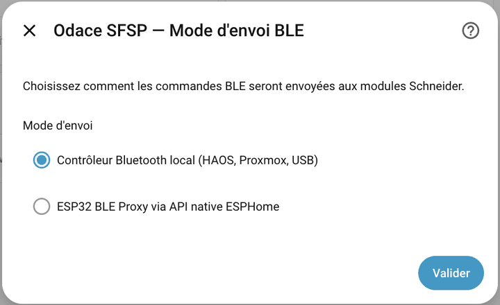

- **HCI**: a Bluetooth controller plugged directly into the machine hosting Home Assistant (Raspberry Pi, NUC, etc.) or passed through over USB to a VM (PROXMOX for example). Home Assistant automatically detects the available adapters (typically `hci0`). This is the simplest and most reliable mode.

<p>
  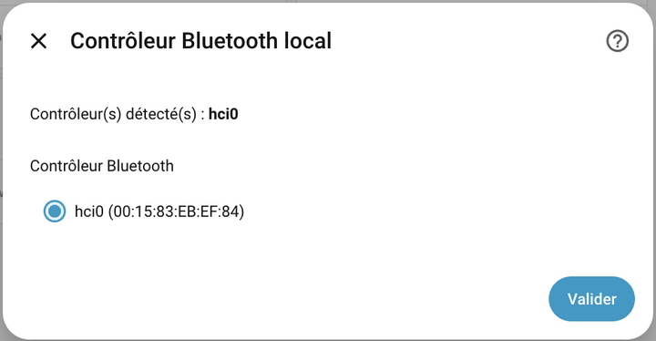
  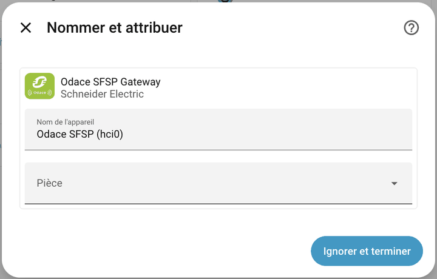
</p>

- **ESPHome**: a remote Bluetooth controller driven by an ESP32 flashed with ESPHome. This mode is useful to extend the range by placing the ESP32 close to the Odace modules. See the [ESPHome configuration](#esphome-configuration) section for the build script.

<p>
  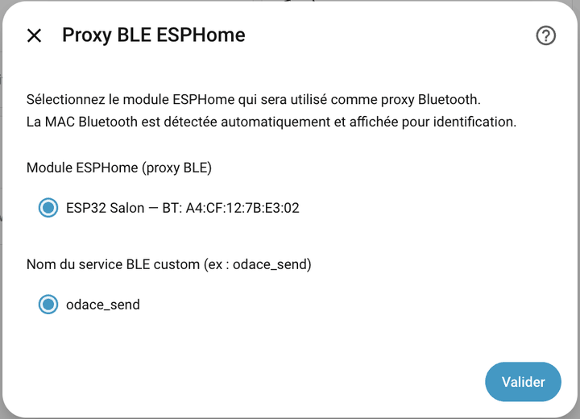
  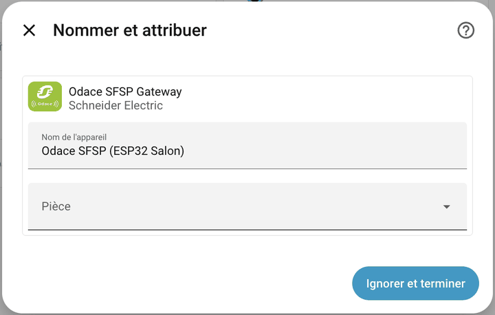
</p>

### Module management menu

From **Settings → Devices & services → Schneider Odace SFSP**, click **Configure** to open the main module management menu. This menu offers the following actions: add, edit, remove or re-pair a module, search a module's scenes, change the Bluetooth controller and open the advanced settings.

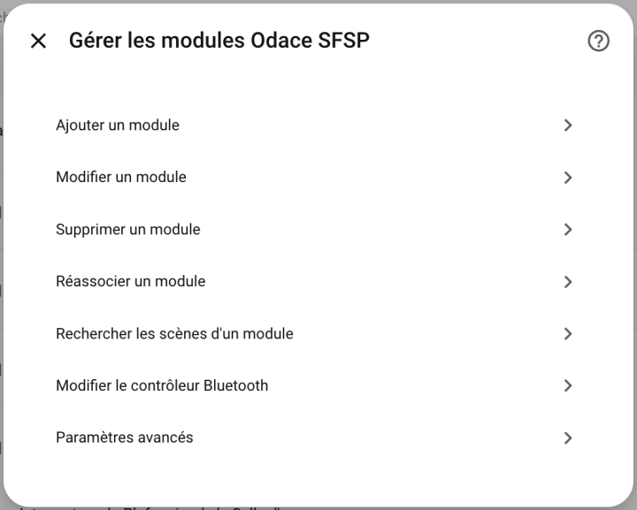

### Adding modules — Pairing

An Odace SFSP module is paired in learning mode:

1. Press the module once to put it in learning mode. It stays in this state for 60 s (blinking red and green).
2. Within the next 60 s, open the **Configure** menu and choose **Add a module**. The screen lists the modules that announced themselves during the last minute, so press the module **before** opening it. If the list is empty, close the screen, press the module again and reopen it.
3. Select the detected module, shown with its UUID and type. Enter a name, check the type (`switch`, `dcl`, `generic`, etc.) and confirm.

For controllable modules (`dcl`, `generic`, `shutter`, `plug`), the pairing frame is sent automatically as long as the module is still blinking. If the delay has elapsed, press the module again: the frame is sent on the press, during the 30 minutes that follow the addition.

A module can also be added without learning mode, by choosing **Enter manually** and typing its UUID (logs/Jeedom format, or module label format).

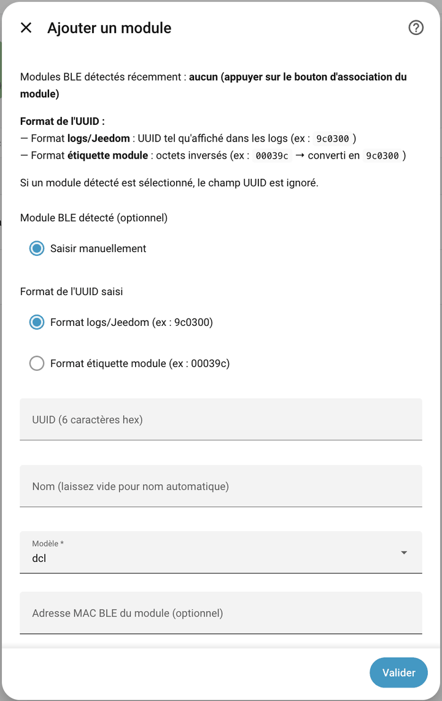

### Editing and removing a module

From the integration's **Configure** menu you can also:

- **Edit a module**: change its name or its type. If the type changes (for example a DCL reclassified as `switch`), the previous entity is removed and a new entity of the right domain is created — no orphan entity is left behind.

<p>
  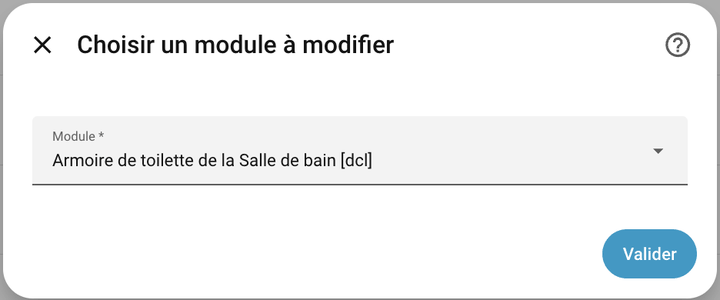
  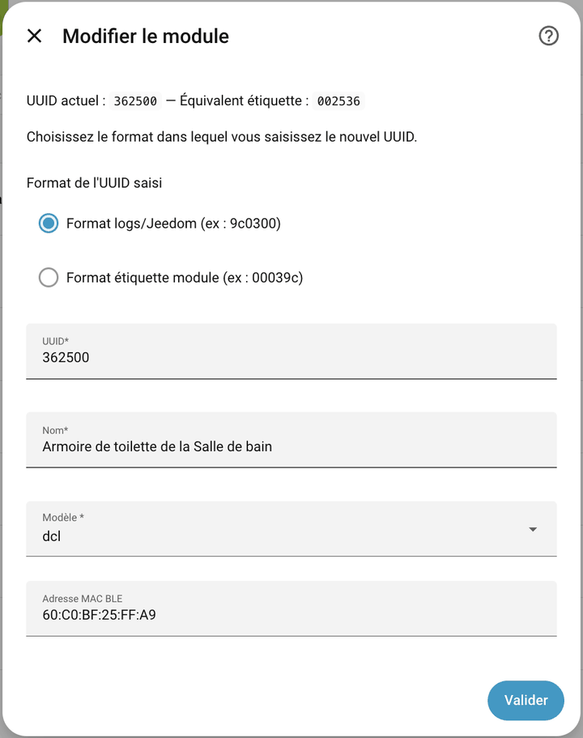
</p>

- **Remove a module**: removes the module from the integration and deletes the associated entity. For a controllable module, the **Unpair the module, then remove from HA** option also breaks the pairing on the module side: a waiting screen asks you to press its button once, and the module is removed only if it confirms unpairing.

<p>
  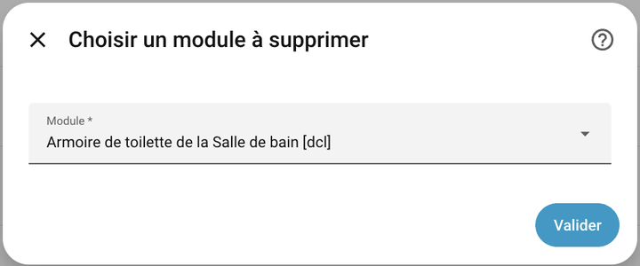
  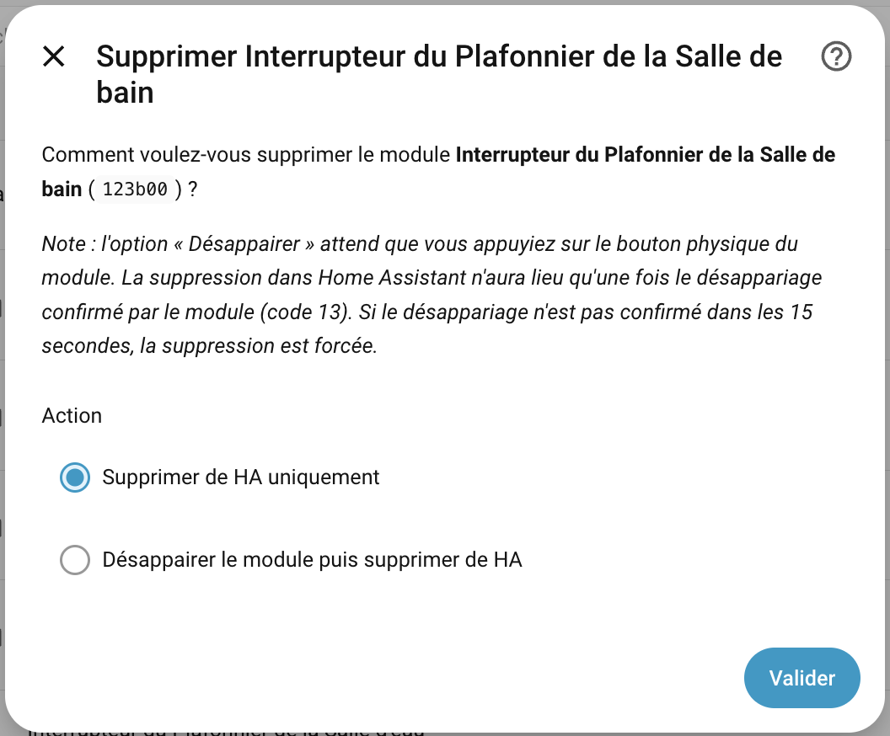
</p>

### Re-pairing a module

The pairing frame is a toggle: it pairs a free module, but unpairs a module that is already paired. The integration therefore only sends it to a module "to be paired", that is, added or marked for re-pairing less than 30 minutes ago. Pressing the button of a working module, for example to pair a wireless switch with it, does not affect its pairing with Home Assistant.

The **Re-pair a module** menu is meant for a module that no longer obeys (reset, or paired with another controller):

1. Choose the module in the list and confirm.
2. Press the module's physical button **once** within 30 minutes: Home Assistant sends it the pairing frame.

If the module was still paired, it unpairs instead of pairing. An alert then appears in **Settings → Repairs**: a second press on its button pairs it again and clears the alert.

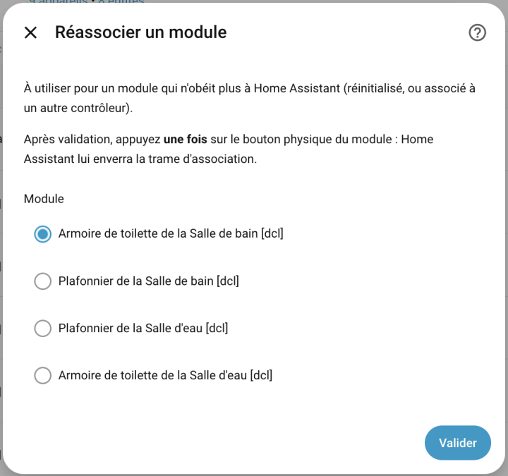

### Searching a module's scenes

A scene is not a physical module: it is an 8-character hexadecimal identifier stored by the modules, of type custom or Schneider. The **Search a module's scenes** menu finds them:

1. Choose a `dcl`, `shutter` or `generic` module that is already registered.
2. Choose the scenes to search: custom, Schneider, or both.
3. Home Assistant queries the module, then creates a `scene` entity for each new scene. The next screen shows the scenes found.

A scene's type can then be changed in **Edit a module**. Scenes have not yet been tested on real hardware.

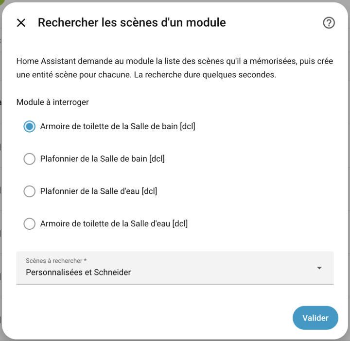

### Changing the Bluetooth controller

The **Change the Bluetooth controller** menu lets you choose another adapter. The MAC address that signs the frames is kept: modules that are already paired keep obeying the new controller, without re-pairing. It can be changed in the advanced settings.

### Advanced settings

The **Advanced settings** menu offers two options:

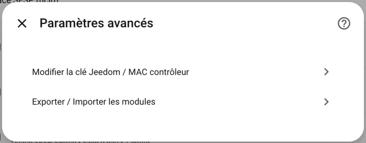

**1. Jeedom key and Bluetooth controller MAC**

Lets you view or change the two key elements inherited from Jeedom:

- The **JEEDOM_KEY** is the encryption key used to sign the BLE frames sent to the Odace modules. It is specific to each installation and can be retrieved from the Jeedom logs.
- The **Bluetooth controller MAC address** is the identifier used when pairing the modules. The MAC address of the original Jeedom Bluetooth controller can be reused with another physical adapter — this is what makes it possible to migrate an existing Jeedom installation to Home Assistant without pairing the modules again.

The same screen offers, for a local Bluetooth controller, the **transmission method**:

- **hcitool** (default): the original method, inherited from the Jeedom plugin. Commands are sent directly to the adapter.
- **Linux kernel** (experimental): frames are handed to the kernel, without `hcitool` and without interrupting Home Assistant's Bluetooth scanning. If it fails, the integration falls back to `hcitool`.

This choice does not exist in ESPHome mode, which is not affected. Feedback on the Linux kernel method is welcome: it is meant to become the default.

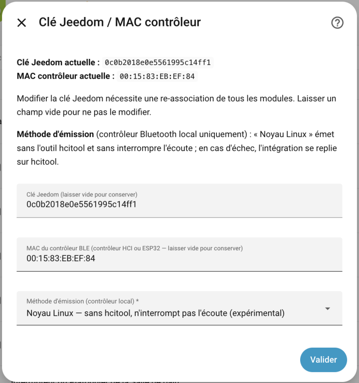

**2. Export / Import of the module configuration**

Lets you back up or restore the full list of paired modules in JSON format. Useful to migrate the integration to a new Home Assistant instance or to pre-fill the modules without going through learning mode again.

- **Export**: the field contains the current list, one line per module, ready to copy.
- **Import**: paste either those lines as they are, or a complete JSON object wrapped in braces. UUIDs already present are skipped, as are lines with an invalid UUID or type.

Importing creates the entities without sending a pairing frame: it suits modules already paired with the configured key and MAC.

Format example:

```json
"943A00": {"uuid": "943A00", "mac": "60:C0:BF:30:2B:16", "model": "switch", "name": "Interrupteur de l'Armoire de toilette de la Salle de bain"},
"123B00": {"uuid": "123B00", "mac": "60:C0:BF:30:2B:75", "model": "switch", "name": "Interrupteur du Plafonnier de la Salle de bain"},
"BF3A00": {"uuid": "BF3A00", "mac": "60:C0:BF:30:2E:39", "model": "switch", "name": "Interrupteur de l'Armoire de toilette de la Salle d'eau"},
"FF3A00": {"uuid": "FF3A00", "mac": "60:C0:BF:30:2B:60", "model": "switch", "name": "Interrupteur du Plafonnier de la Salle d'eau"}
```

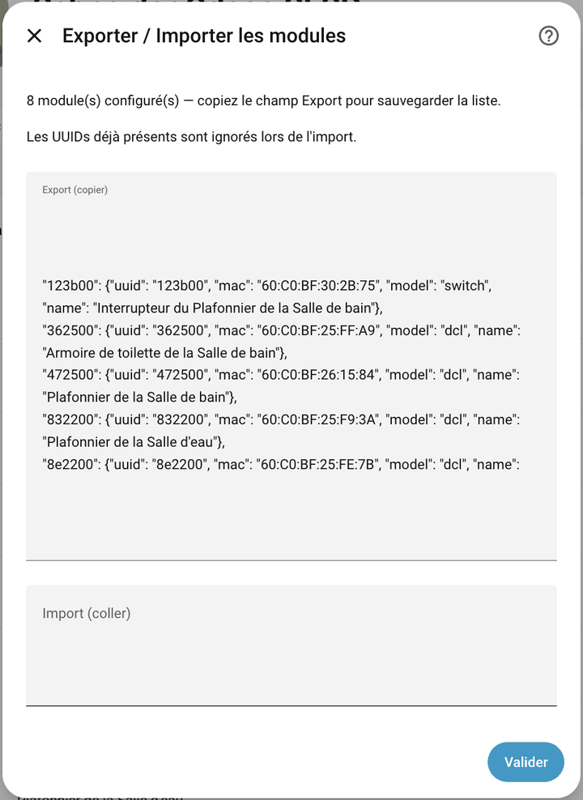

### ESPHome configuration

To use an ESP32 as a Bluetooth relay (ESPHome mode), the firmware must expose an `odace_send` service that sends a raw BLE frame. Here is the configuration fragment to add to your `esphome/*.yaml` file:

```yaml
api:
  encryption:
    key: !secret api_doorbell
  services:
    - service: odace_send
      variables:
        payload: string
      then:
        - lambda: |-
            std::vector<uint8_t> data;
            for (size_t i = 0; i + 1 < payload.size(); i += 2)
              data.push_back((uint8_t)strtol(payload.substr(i, 2).c_str(), nullptr, 16));
            esp_ble_gap_config_adv_data_raw(data.data(), data.size());
            esp_ble_adv_params_t p{};
            p.adv_int_min = p.adv_int_max = 0x20;
            p.adv_type    = ADV_TYPE_NONCONN_IND;
            p.own_addr_type = BLE_ADDR_TYPE_PUBLIC;
            p.channel_map = ADV_CHNL_ALL;
            esp_ble_gap_start_advertising(&p);
            delay(500);
            esp_ble_gap_stop_advertising();
```

This service receives the hexadecimal frame built by the integration, decodes it byte by byte and broadcasts it as a non-connectable BLE advertisement, reproducing exactly the behaviour of the Jeedom daemon.

## Debugging help

If the integration does not behave as expected (module not detected, command with no effect, error at startup), here is how to collect the information needed to report a problem.

### Enabling debug logs

Add the following lines to `configuration.yaml`:

```yaml
logger:
  default: warning
  logs:
    custom_components.odace_sfsp: debug
```

Restart Home Assistant (**Settings → System → Restart**).

### Retrieving the logs

1. Go to **Settings → System → Logs**.
2. Filter on `odace_sfsp`.
3. Copy the relevant entries (hex frames received or sent, error messages).

### Reporting a problem

Open an issue on the [GitHub repository](https://github.com/slemeur91/odace_sfsp/issues) and include:

- A description of the malfunction (what is expected, what actually happens).
- The type of module involved (`switch`, `dcl`, `generic`, etc.) and its UUID if known.
- The debug logs collected above.
- The version of the integration and of Home Assistant.

---

[releases-shield]: https://img.shields.io/github/release/slemeur91/odace_sfsp.svg?style=flat-square
[releases]: https://github.com/slemeur91/odace_sfsp/releases
